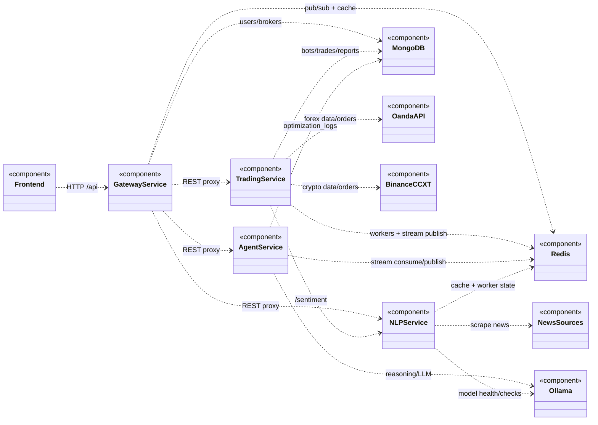

# TradePilot Component Diagram

This component view is based on the current implementation in:
- `gateway-service/src/routes/proxyRoutes.js`
- `gateway-service/src/services/serviceProxy.js`
- `trading-service/app/core/lifespan.py`
- `trading-service/app/services/agent_trigger.py`
- `agent-service/app/workers/agent_worker.py`
- `nlp-service/app/core/lifespan.py`

## UML Component View (Mermaid)

## Provided and Required Interfaces

| Component | Provides | Requires |
|---|---|---|
| Frontend | `IUserDashboard` | `IWebFrontDoor` |
| Gateway Service | `IWebFrontDoor` (`/api/*`, auth, WS health) | `ITradingApi`, `INlpApi`, `IAgentApi`, `IMongoStore`, `IRedisBus` |
| Trading Service | `ITradingApi` (bots, trades, backtest, data, broker) | `INlpApi`, `IMongoStore`, `IRedisBus`, `IForexMarket`, `ICryptoMarket` |
| NLP Service | `INlpApi` (parse, sentiment, news) | `IRedisBus`, `INewsFeeds`, `IOllamaInference` |
| Agent Service | `IAgentApi` (reasoning, PPO, optimization logs) | `IMongoStore`, `IRedisBus`, `IOllamaInference` |
| MongoDB | `IMongoStore` | - |
| Redis | `IRedisBus` (cache, pub/sub, streams) | - |
| OANDA API | `IForexMarket` | credentials/network |
| Binance via CCXT | `ICryptoMarket` | credentials/network |
| News Sources | `INewsFeeds` | internet access |
| Ollama | `IOllamaInference` | model runtime/network |

## Notes

- `Gateway -> Trading/NLP/Agent` is synchronous HTTP proxying.
- `Trading -> Agent` behavior is asynchronous in practice via Redis stream (`agent.trigger` / `bot.update`), not direct REST.
- If you need strict UML ball-and-socket notation for grading, use this interface table directly in EdrawMax/StarUML and wire the same dependencies.
