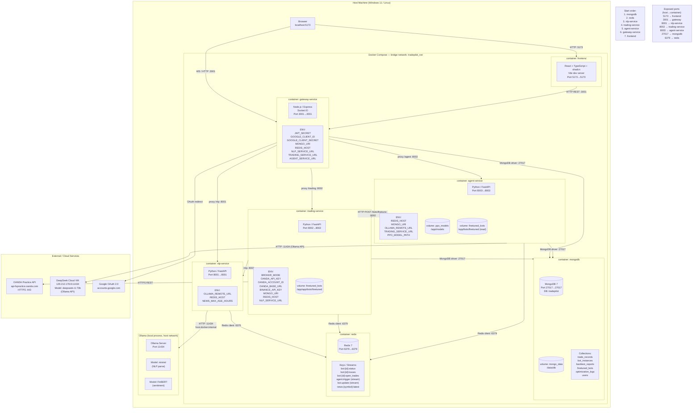

# TradePilot — Deployment Diagram

## Volume Summary

| Volume | Mounted In | Path | Purpose |
|--------|-----------|------|---------|
| `mongo_data` | mongodb | `/data/db` | Persistent trade & bot data |
| `ppo_models` | agent-service | `/app/models` | Trained PPO model weights |
| `finetuned_bots` | trading-service | `/app/app/bots/finetuned` | Agent-generated bot files (write) |
| `finetuned_bots` | agent-service | `/app/bots/finetuned` | Same volume, read access |

## Network Summary

| Network | Type | Members |
|---------|------|---------|
| `tradepilot_net` | Docker bridge | All 7 containers |
| Host loopback | host process | Ollama (Mistral + FinBERT) |
| Internet | HTTPS/443 | OANDA Practice API, Google OAuth |
| Internet | HTTP/11434 | DeepSeek Cloud VM (129.212.178.8) |
