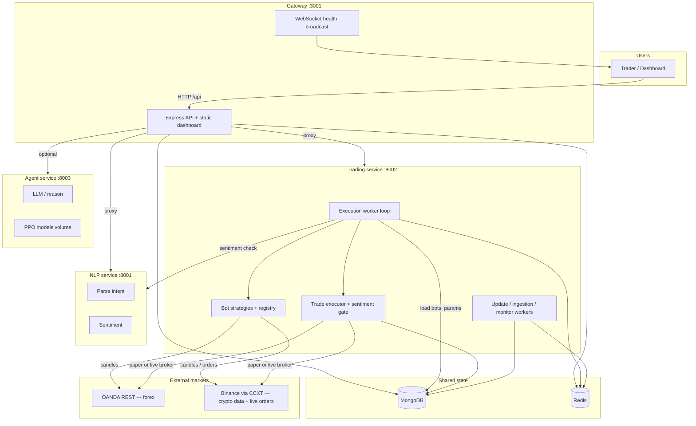
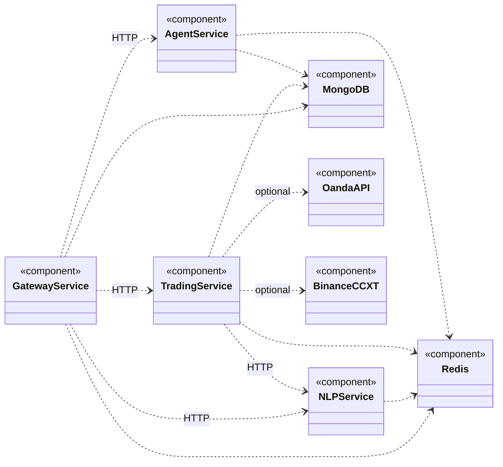
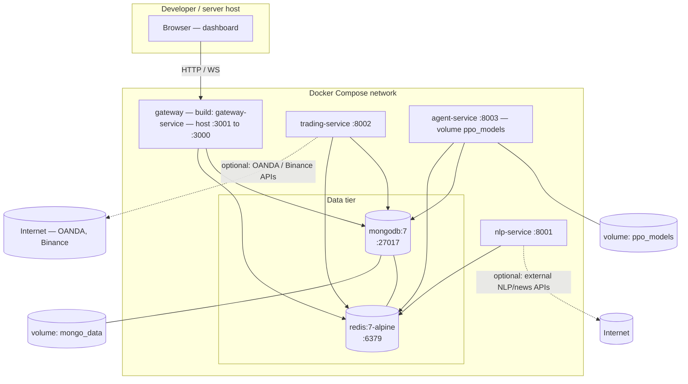

# TradePilot — Milestone 3 diagrams

Source: `docker-compose.yml`, `gateway-service`, `trading-service`, `nlp-service`, `agent-service`.

Render these in GitHub, VS Code (Mermaid preview), or [mermaid.live](https://mermaid.live).

---

## 1. Operational diagram (runtime / workflows)

Shows how a **signal becomes a trade** and how **background workers** run. Operational = *what happens when the system runs*.

**Narrative (one paragraph for the report):** The user talks to the **gateway**, which authenticates and proxies API calls to **trading**, **NLP**, and **agent** services. **MongoDB** holds bots and trades; **Redis** holds cached params and pub/sub. On a timer, the **execution worker** loads active bots, pulls candles (OANDA forex or CCXT/Binance crypto), runs strategy logic, optionally asks **NLP** for sentiment, then executes via **paper** or **live** adapters. The gateway pushes **service health** over WebSockets to the dashboard.

---

## 2. UML component diagram (structural view)

### Purpose (step 1)

Show **TradePilot** as **encapsulated, replaceable components** (each deployable service + data stores + external systems), the **interfaces** they **provide** (operations others may call) and **require** (contracts they depend on), and **dependencies** between components. This matches standard UML: **structure and interface contracts**, not physical deployment (see §3 for deployment).

### UML notation (quick reference)

| Notation | Meaning |
|----------|---------|
| **Component** | Logical unit (often one deployable); in tools: rectangle with **small tab** on the upper-right. |
| **Provided interface** | What this component **offers** — UML **lollipop** (ball) on the component edge. |
| **Required interface** | What this component **needs** — UML **socket** (half-circle) on the component edge. |
| **Assembly** | Wiring **provided** to **required** (ball fits socket). |
| **Dependency** | “Uses” — **dashed arrow** (dependency may change independently). |
| **Port** (optional) | Named connection point when the component **delegates** an interface inward. |

**EdrawMax:** *File → Software → UML Modelling → Component Diagram* → use **Component**, **Provided Interface**, **Required Interface**, **Dependency** from the library.

### Components and grouping (step 2)

| Component | Role | Internal parts (for a detailed view) |
|-----------|------|--------------------------------------|
| **Gateway Service** | Entry: HTTP API, static dashboard, WebSocket health | Auth, proxy, broker/user routes, Redis pub/sub |
| **NLP Service** | Parse, sentiment, news APIs | Routers under FastAPI |
| **Trading Service** | Bots, data, execution, backtests | Routers, bot registry/strategies, adapter factories, workers |
| **Agent Service** | Reasoning, PPO, optimization logs | Routers; models on `ppo_models` volume |
| **MongoDB** | Document store | — |
| **Redis** | Cache, params, pub/sub | — |
| **OANDA API** *(external)* | Forex REST (practice/live) | — |
| **Binance / CCXT** *(external)* | Crypto OHLCV + orders via CCXT | — |

### Provided vs required interfaces (steps 3–4)

Use these to draw **lollipops** (provided) and **sockets** (required) in EdrawMax.

**Gateway Service**

| Provides | Requires |
|----------|----------|
| `IWebFrontDoor` — HTTP `/api/*`, static UI, dashboard | `IMongoStore`, `IRedisCache` |
| `IHealthStream` — WebSocket health feed | `INlpRestApi`, `ITradingRestApi`, `IAgentRestApi` (HTTP) |

**NLP Service**

| Provides | Requires |
|----------|----------|
| `INlpRestApi` — parse, sentiment, news (`:8001`) | `IRedisCache` (optional features) |

**Trading Service**

| Provides | Requires |
|----------|----------|
| `ITradingRestApi` — bots, trades, backtest, data, broker (`:8002`) | `IMongoStore`, `IRedisCache`, `INlpRestApi` |
| *(internal)* market access | `IForexMarket` (OANDA), `ICryptoMarket` (CCXT/Binance) |

**Agent Service**

| Provides | Requires |
|----------|----------|
| `IAgentRestApi` — reason, PPO, optimization logs (`:8003`) | `IMongoStore`, `IRedisCache`, local model files |

**MongoDB / Redis**

| Provides | Requires |
|----------|----------|
| `IMongoStore` / `IRedisCache` | *(none in this diagram scope)* |

**External systems**

| Provides | Requires |
|----------|----------|
| `IForexMarket` (OANDA), `ICryptoMarket` (Binance) | Credentials / network |

### Mermaid view (dependencies; use EdrawMax for full UML ball/socket)

Mermaid does not render the **component tab + lollipop + socket** as in classic UML. Below, `<<component>>` stereotypes mark components; **`..>`** = dependency (dashed in Mermaid). Recreate **interfaces** as ball/socket pairs using the table above.

**Reading the diagram:** Each box is a **UML component** (`<<component>>`). Dashed arrows are **dependencies**: the **source** component **requires** services from the **target** (REST, DB, cache, or external broker). Map these edges to **provided/required** interfaces in EdrawMax (e.g. Trading **requires** `INlpRestApi` **provided by** NLP).

### Submission checklist

1. Purpose stated.  
2. Components grouped (gateway, NLP, trading, agent, data, externals).  
3. Interfaces named (tables above).  
4. Dependencies shown (Mermaid + matching dashed arrows in EdrawMax).  
5. Optional: nested diagram for **Trading Service** (routers vs workers vs adapters).

---

## 3. Deployment diagram (Docker Compose)

Maps **containers**, **ports**, **volumes**, and **host** access. Deployment = *where things run*.

**Compose notes (for captions):**

| Service         | Host port | Depends on      |
|----------------|-----------|-------------------|
| gateway        | 3001      | Mongo, Redis      |
| nlp-service    | 8001      | Redis             |
| trading-service| 8002      | Mongo, Redis      |
| agent-service  | 8003      | Mongo, Redis      |
| mongodb        | 27017     | —                 |
| redis          | 6379      | —                 |

`extra_hosts: host.docker.internal` allows containers to reach services on the host when needed (see `docker-compose.yml`).

---

## Export tips

- **PNG/SVG:** Paste each Mermaid block into [mermaid.live](https://mermaid.live) and export.
- **Word/PowerPoint:** Export SVG, then insert; or use a Mermaid add-in.
- **Thesis PDF:** Same as above, or use `mmdc` (Mermaid CLI) if you add it to the project later.

For **formal UML**, use **§2** tables + **EdrawMax** ball/socket notation; **§3** maps to **UML deployment** (nodes = containers + host). The Mermaid **classDiagram** in §2 emphasizes **dependencies** only.
